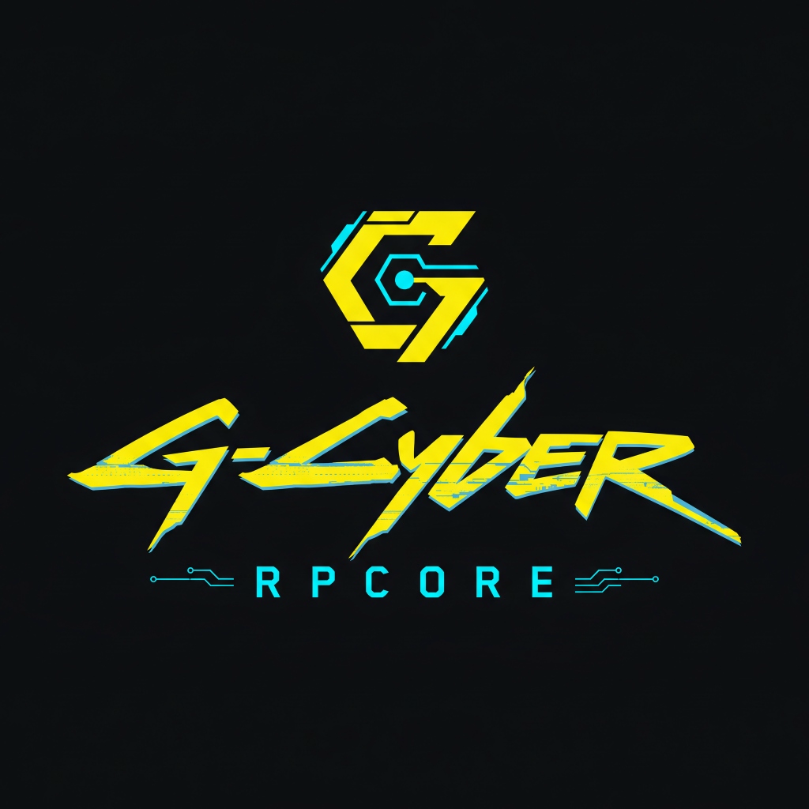
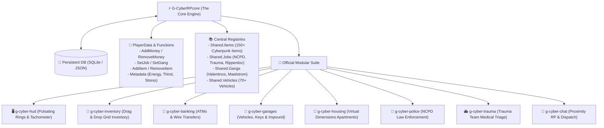

<div align="center">

  

  # ⚡ G-CyberRPcore

  **The Definitive, Modular & High-Performance Roleplay Framework for Cyberpunk 2077 (CyberMP)**
  
  *Pioneering the Next Generation of Multiplayer Roleplay in Night City — Built from the Ground Up for CyberMP.*

  [](https://cyber.mp)
  [](https://www.typescriptlang.org/)
  [](https://github.com/G-CyberRPcore)
  [](https://opensource.org/licenses/MIT)

</div>

---

## 🌆 Welcome to G-CyberRPcore

**CyberMP** has ushered in a revolutionary new era for *Cyberpunk 2077*, enabling dedicated multiplayer servers. **G-CyberRPcore** is created to seize this historic milestone: establishing the premier, standard, open-source framework that powers every serious roleplay server in Night City.

Built natively from the ground up for **CyberMP**, G-CyberRPcore delivers an original, extensible, event-driven foundation with rich developer APIs, persistent character data, deep economic mechanics, and a breathtaking, futuristic user experience.

---

## 🏛️ Architectural Overview



---

## 💎 Key Features

* **Universal PlayerData Object:** Every citizen has structured attributes (`citizenid`, `charinfo`, `money`, `job`, `gang`, `metadata`) with fluent helper methods.
* **Futuristic Cyberpunk HUD:** Pulsating neon gauge rings, dynamic voice wave analyzer, health/armor, and responsive speedometer.
* **Next-Gen Grid Inventory:** Drag-and-drop slots, item weight constraints, fast-access hotbar (1-5), and custom container support (trunks, stashes).
* **True Virtual Dimensions Housing:** Instanced apartments (Megabuilding H10, The Glen, Corpo Plaza) allowing unlimited players to own properties without visual collision.
* **Comprehensive Career Hierarchy:** Multi-tier rank structures for legal careers (NCPD, Trauma Team, Ripperdocs) and illegal syndicates.
* **Standardized Callback System:** Seamless async Request/Response handling across Server, Client, and CEF browser UI.

---

## 📦 Official Repositories

| Repository | Description | Status |
| :--- | :--- | :--- |
| [**`G-CyberRPcore`**](https://github.com/G-CyberRPcore/G-CyberRPcore) | The complete core framework, shared registries, and modular server suite. | 🚀 Active |
| [**`.github`**](https://github.com/G-CyberRPcore/.github) | Organization profile, community guides, and master documentation. | 📖 Documentation |

---

## 🚀 Quick Installation for Server Owners

1. Ensure you have installed [CyberMP Server](https://docs.cyber.mp).
2. Clone `G-CyberRPcore` into your server's `resources` directory:
   ```bash
   cd resources/
   git clone https://github.com/G-CyberRPcore/G-CyberRPcore.git
   ```
3. Add the resource to your `server.toml`:
   ```toml
   resources = [
     "G-CyberRPcore"
   ]
   ```
4. Start your server:
   ```bash
   .\cybermp-server.exe -run
   ```

---

## 🤝 Contributing & Community

We are actively building the future of *Cyberpunk 2077* multiplayer. Developers, UI/UX designers, and server creators are warmly invited to contribute:
- Open an Issue or submit a Pull Request.
- Follow our coding standards and modular naming conventions.

---

<div align="center">
  <sub>Developed with passion for the CyberMP & Cyberpunk 2077 Community. Distributed under the MIT License.</sub>
</div>
